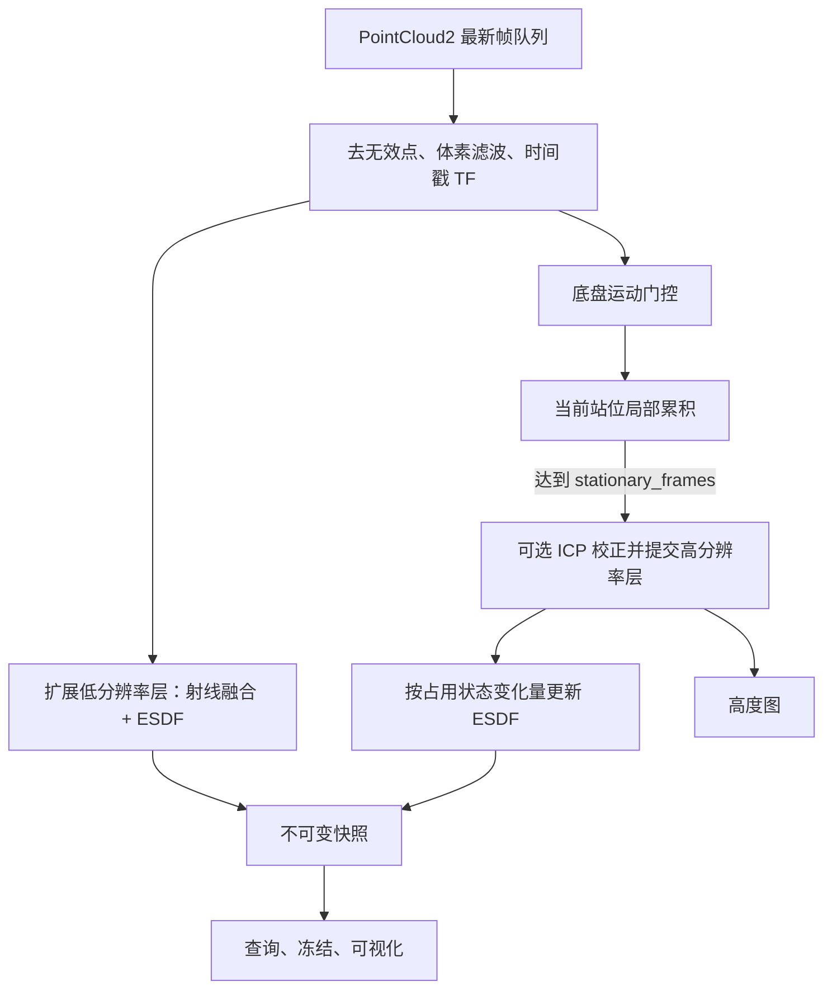

# 架构与算法

## 数据流

`grid_map_pipeline.cpp` 只编排步骤。点云转换在 `grid_map_cloud.cpp`；站位融合和 ESDF 更新策略在 `grid_map_fusion.cpp`；各算法不管理 ROS 订阅或线程。

## 双层地图与任务

高层窗口是输入任务多边形的轴对齐包围盒，低层窗口向四周扩张固定 `expansion_margin`。各维尺寸向上取整到体素边界，Z 范围为 `[0, map_size_z)`。原多边形另存为 `source_roi_polygon`，用于擦拭区域评分；建图裁剪使用矩形窗口。

两层拥有独立的占用模型、可选 TSDF 和 ESDF 策略。低层每个有效点云帧更新，包括等待首个运动基准、底盘移动、高层滤波无有效点和 ICP 拒绝的情况。高层先累积站位原始射线和配准表面点，达到配额后一次性重放进全局体素并提交；新站位的 ICP 拒绝时清空局部累积，等待重新采集。

运动门控使用点云时间戳对应的 `motion_frame` TF，同时比较相邻位姿和当前站位锚点，检测缓慢累计漂移。首次位姿只建立基准；`stationary_frames=N` 至少还需要 N 帧成功融合。没有底盘 TF 时退回相机 TF。当前没有独立的 `stationary_since` 时间窗口门控，历史设计中的该方案尚未实现。

高度图只读取当前站位已提交的高层占用数据。`ready_to_move`、规划可用条件和高度图共享一次站位提交边界，不再有额外的“最低帧数”。

停止或替换任务会关闭输入队列、递增任务代次、清空地图和冻结快照。旧代次已取出的点云也会被拒绝。已持有的旧快照仍可安全读取。

## 算法

- 占用：射线穿越体素积累 miss，端点积累 hit，Log-odds 饱和限制；未知、自由、占用三态独立于 ESDF 的未知空间策略。
- TSDF：可选，仅融合表面截断带内的投影距离，复用占用射线遍历；默认关闭。
- 支撑过滤：可选，仅作用于高层每帧内部 hit；以地面高度带为种子做六邻域连通搜索，保留边界端点和地面清空射线。
- ICP：当前站位局部表面点对齐已提交表面点，仅在跨站位提交时执行，并检查重叠、适配误差和校正幅度。
- ESDF：三轴一维精确平方距离变换。正距离来自障碍，负距离来自自由侧；无源时使用 `max_distance`。每个 OpenMP 工作线程复用行缓冲区，按连续 Z、Y、X 顺序扫描，轴之间保留同步屏障，小体积串行执行。每个体积默认最多 2 个线程，不改变全局 OpenMP 配置。全量模式正负距离复用同一临时体积，均匀场直接填充。默认局部模式保留正负 Z/Y 中间平方距离，源变化从 Z 列传播到受影响的 Y、X 行；每条行包含完整轴向源，障碍新增/删除均保持全局精确结果。
- 高度图：垂直柱在状态高度带内找最低障碍，按工具/视觉/顶面阈值分类；完整度在独立高度带内统计已知比例。

## 快照与查询

位置查询先选高层几何，超出高层才选低层；高层未知不会自动退回低层。整数索引查询始终属于高层。`getPreciseDistance()` 在选定层内三线性插值，边缘退回所在体素，避免跨层插值。

两层之外返回距离 `100000.0`、占用 `-1`；调用方需要自行处理越界。冻结查询选择同一份不可变快照，任务切换会清除冻结状态。

`version` 只在高层提交或任务失效时前进；低层实时更新会替换快照指针，但保持高层版本号。`esdf_current=false` 表示高层距离场尚未建立，或占用发生少量变化而复用了旧距离场。低层每帧检查障碍源，源不变时复用完全相同的距离场；源变化时默认只重算受影响的轴向行。高层触发重算时也采用相同局部算法。若要求高层占用和距离严格同步，设置 `esdf_recompute_change_voxels=0`。

## 并发与性能

一个工作线程串行写入两层地图，ROS 点云回调仅替换容量为一的最新帧队列。任务锁保护地图状态；锁顺序是任务锁 → 运动/快照/队列锁，工作线程在获取任务锁前释放队列锁。查询持有不可变快照，避免遍历正在修改的体素。

优先增大点云滤波叶尺寸、低层分辨率或减少实验像素采样密度，再缩小地图范围；体素数随三维分辨率快速增长。ESDF 热路径不再逐行分配临时数组，变化统计达到重算阈值便停止扫描，没有 ICP 校正时直接重放原射线，避免复制整站射线列表。删除了从未被读取的局部占用/TSDF 密集体积，累积阶段只做常数时间的射线与窗口相交检查，不重复遍历每个体素。占用体素仅保存 Log-odds，移除未被消费的 hit/miss 计数后，从 8 字节缩减为 4 字节。

高层 ICP 和提交仍会暂停同一线程上的低层刷新；快照仍复制两层体素数组；高层未提交时复用上次概率和状态数组，避免重复执行逐体素概率转换。局部更新额外保存中间缓存；源分类和快照复制仍遍历全体积，变动范围大时距离更新也可能覆盖全图。这些是当前性能边界，并未实现严格实时截止时间或分块共享快照。应在实际相机点数和地图尺寸下测量延迟。

性能对比、测量边界和复现命令见 [性能验证](performance.md)。

局部更新开关、缓存开销和基准见 [局部更新说明](local_updates.md)。
