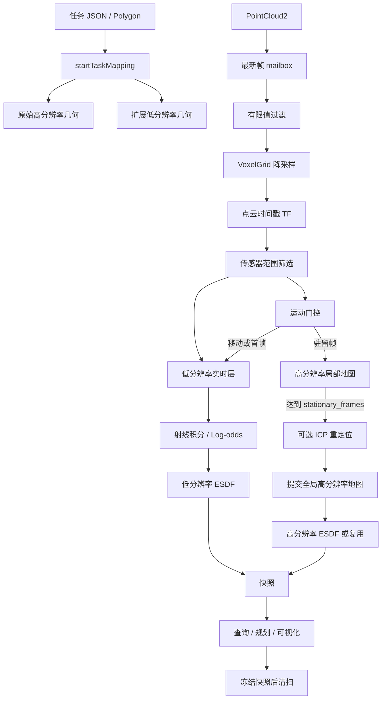

> 历史设计记录：不作为当前代码、参数或运行方式的依据。当前入口见 [README](../../README.md)。

# `plan_env` 功能实现报告

本文以当前工作区 `mobile_manipulator_controller/whole_body_planner/plan_env` 的源码为准，说明从任务区域接收、点云进入、TF 变换、运动门控、双分辨率体素融合、ESDF 计算、查询冻结，到观测规划和仿真评估的完整实现。文中所说的“当前实现”以以下文件为准：

- 核心地图接口：[grid_map.hpp](../include/plan_env/grid_map.hpp)
- 地图生命周期和任务区域：[grid_map.cpp](../src/grid_map.cpp)
- 点云、TF 和双层融合：[grid_map_cloud.cpp](../src/grid_map_cloud.cpp)
- 运动门控和驻留提交：[grid_map_motion.cpp](../src/grid_map_motion.cpp)
- 坐标、查询和冻结：[grid_map_query.cpp](../src/grid_map_query.cpp)
- 快照、点云导出：[grid_map_snapshot.cpp](../src/grid_map_snapshot.cpp)
- 高度图：[height_map.cpp](../src/height_map.cpp)
- 占用、射线、TSDF、ESDF 和 ICP：[occupancy.cpp](../src/occupancy.cpp)、[ray_casting.cpp](../src/ray_casting.cpp)、[tsdf.cpp](../src/tsdf.cpp)、[esdf.cpp](../src/esdf.cpp)、[registration.cpp](../src/registration.cpp)
- 主动观测规划：[observation_planner.cpp](../src/observation_planner.cpp)、[observation_planner_node.cpp](../src/observation_planner_node.cpp)
- 独立可视化节点：[grid_map_standalone_test.cpp](../src/grid_map_standalone_test.cpp)

报告中的默认值需要区分两种情况：库对象直接构造时使用头文件中的默认值；ROS 节点调用 `initMap()` 后，会读取 `grid_map.*` 参数并覆盖这些默认值；Gemini 336 launch 文件又会覆盖一部分 ROS 参数。调试时应以实际节点打印的参数和 launch 文件为最终值。

## 1. 系统职责和总体架构

`plan_env` 提供一个线程化的 `GridMap` 环境地图。它不是单独的规划器，而是向全身规划器提供以下能力：

1. 根据清扫任务多边形建立地图窗口和体素数组。
2. 接收 `sensor_msgs/msg/PointCloud2`，完成有限值过滤、降采样、TF 变换和传感器范围筛选。
3. 根据底盘或相机运动判断当前点云是否属于同一驻留位置。
4. 在低分辨率扩展地图中实时更新局部占用和 ESDF。
5. 在高分辨率原始任务地图中积累驻留帧，达到配额后提交到全局地图。
6. 对提交后的高分辨率占用图计算 ESDF，并发布不可变快照。
7. 提供体素查询、三线性距离查询、冻结快照、PCD 导出和高度分类图。
8. 提供一个基于未知区域、开口和机械臂入口检查的主动观测规划器。

核心数据流如下：



低分辨率层用于扩大实时感知范围，允许在机器人移动时更新；高分辨率层用于原始任务区域和清扫判定，只在驻留局部地图完成后提交。快照同时保存两层数据，因此查询可以在任务区域内使用高分辨率，任务区域外使用扩展低分辨率。

## 2. 对象生命周期和任务生命周期

### 2.1 `GridMap` 构造和析构

`GridMap` 构造函数创建 `tf2_ros::Buffer` 和 `TransformListener`，初始化一个空快照，并启动一个后台 `mapping_thread_`。线程一直等待点云 mailbox；析构时设置 `stopping_`、唤醒条件变量并等待线程退出。

`initMap(node)` 必须由拥有该地图的 ROS 节点调用。该函数完成参数读取、占用/ESDF/TSDF/ICP 配置、点云订阅和可选高度图发布器创建。点云订阅使用可靠 QoS，话题名默认是相对名称 `grid_map/cloud`。独立节点和 Gemini 实验把该名称设置为 `/camera/depth/points`。

### 2.2 配置阶段

以下配置接口只能在任务尚未启动时修改；任务已经有效时返回 `false`：

- `configure()`、`configureDualResolution()`：体素分辨率、Z 范围和扩展边距。
- `configureOccupancy()`、`configureLowOccupancy()`：两层 Log-odds 模型。
- `configureEsdf()`、`configureLowEsdf()`：两层 ESDF 策略。
- `configureTsdf()`、`configureLowTsdf()`：两层可选 TSDF。
- `configurePointCloudFilter()`：点云体素降采样叶尺寸。
- `configureRegistration()`：ICP 参数。
- `configureMotion()`：平移/旋转门限和驻留帧配额。

配置函数会检查非有限数、负数、上下界关系和配额关系。任务启动后修改参数不会自动重建已有体素数组，必须先停止任务再配置。

### 2.3 任务启动 `startTaskMapping()`

输入是 `std::vector<Eigen::Vector2d>`，通常来自 `/area_designation` 或全身规划器的清扫请求。启动流程为：

1. 删除非有限顶点。
2. 删除与上一个顶点几乎重合的顶点。
3. 如果首尾几乎重合，删除重复闭合点。
4. 剩余顶点少于 3 个时拒绝任务。
5. 计算输入多边形的 XY 轴对齐包围盒。
6. 用 `expansion_margin` 向四周扩展。
7. 高分辨率地图使用原始包围盒，低分辨率地图使用扩展包围盒。
8. Z 范围固定为 `[0, map_size_z]`。
9. 按分辨率向上取整体素数量，分配占用、ESDF 和可选 TSDF 数组。
10. 清空运动状态、驻留局部地图、ICP 目标缓存和旧快照，允许新任务的点云进入 mailbox。

需要特别区分以下几何字段：

| 字段 | 来源 | 用途 |
| --- | --- | --- |
| `source_polygon` | 原始输入顶点 | 观测规划器判断原始任务区域，保留真实多边形形状 |
| `original_polygon` | 原始包围盒 | 高分辨率地图窗口和原始查询区域 |
| `expanded_polygon` | 扩展包围盒 | 低分辨率地图窗口和入口/安全通道检查 |
| `grid_geometry_` | 原始包围盒 + 高分辨率 | 高分辨率体素数组，原点位于原始包围盒最小角 |
| `low_grid_geometry_` | 扩展包围盒 + 低分辨率 | 低分辨率体素数组，原点位于扩展包围盒最小角 |

当前实现最终使用轴对齐矩形作为地图裁剪窗口。原始多边形不会作为高分辨率体素逐点裁剪边界，但会保存在快照中供观测规划器使用。代码会校验 `expansion_ratio`，但任务窗口实际只使用固定 `expansion_margin`，这一点在参数表中单独标出。

### 2.4 任务停止

`stopTaskMapping()` 会使当前任务代次失效、停止接收点云、清空体素和局部地图、重置运动状态，并把实时和冻结快照替换为空快照。旧任务 mailbox 中的点云带有旧 `task_generation_`，后台线程即使取到也会被丢弃。

## 3. 点云进入和预处理全流程

### 3.1 最新帧 mailbox

ROS 回调只做轻量操作：检查地图是否允许接收，将 `pending_cloud_` 替换为最新消息，然后通知后台线程。因此 mailbox 只保留一帧，旧帧可能在处理前被覆盖。这种设计限制了延迟增长，但点云高于处理能力时会主动丢帧。

后台 `mappingLoop()` 取出点云和对应任务代次，调用 `processQueuedCloud()`。处理期间持有任务状态锁，保证任务切换和代次检查一致。

### 3.2 点云清洗和降采样

`processPointCloud()` 依次执行：

1. 将 ROS 点云转换为 `pcl::PointCloud<pcl::PointXYZ>`。
2. 删除 `x/y/z` 任一不是有限数的点。
3. 使用 PCL `VoxelGrid`，叶尺寸为 `cloud_leaf_size`（兼容旧参数名 `point_cloud_leaf_size`）。
4. 删除距离过近或超出传感器局部范围的点：
   - `abs(x) < local_update_range_x`
   - `abs(y) < local_update_range_y`
   - `abs(z) < local_update_range_z`
   - `norm(point) > cloud_min_range`

降采样发生在传感器坐标系；之后保留的点仍是传感器坐标，等待带时间戳的 TF 变换。空消息、缺少 `frame_id`、全为非有限点、降采样后为空或范围筛选后为空都会被拒绝。

### 3.3 TF 和运动位姿

点云时间戳用于查询 `map_frame <- cloud.header.frame_id`，等待时间为 0.05 s。点云坐标转换矩阵作为 `prepared.prior_pose`，用于把点和相机原点变换到地图坐标。

运动门控优先查询 `map_frame <- motion_frame`。默认 `motion_frame` 是 `base_footprint`；如果该 TF 不存在，则退回点云帧位姿。这样机械臂或相机自身的小幅变化不会被误认为底盘移动；没有底盘 TF 的系统仍可以运行，但相机运动会参与门控。

### 3.4 地图内点筛选

高分辨率点必须落在 `TaskRegion::containsOriginal()` 中；低分辨率点必须落在 `TaskRegion::contains()` 中。低于 `cloud_min_map_z` 的点默认丢弃。如果 `cloud_low_z_clear_rays=true`，低点保留为清空射线，但终点不会产生占用 hit。这样可以保留地板回波对自由空间的 miss 证据，同时不把地面本身判为障碍。

## 4. 运动门控和驻留提交

### 4.1 状态定义

`MotionState` 有四个值：

| 状态 | 含义 |
| --- | --- |
| `kWaitingForPose` | 没有上一帧有效运动位姿，或正在建立新驻留锚点 |
| `kMoving` | 当前帧相对上一帧或驻留锚点的变化超过门限，当前高分辨率帧不融合 |
| `kStationaryCollecting` | 当前驻留位置已建立，帧正在进入局部高分辨率地图 |
| `kReadyToMove` | 当前驻留局部地图达到配额并已经提交到全局地图 |

平移比较使用欧氏距离，旋转比较使用两个四元数相对旋转的 `AngleAxis` 角度。只要相邻帧变化或相对驻留锚点变化超过任一门限，就进入 `kMoving`，清空局部地图并等待新锚点。

### 4.2 一帧点云的门控顺序

`processPointCloudFrame()` 的顺序很重要：

1. 先用当前 TF 更新低分辨率层。即使底盘正在移动，低分辨率层也可以更新。
2. 执行运动门控。首个有效位姿只建立比较基准，不能直接作为驻留融合帧。
3. 如果门控拒绝当前帧，高分辨率局部地图不变；如果低层已经成功更新，仍会发布低层刷新快照。
4. 如果门控接受，使用 `station_pose_correction_ * prior_pose` 生成高分辨率地图点。
5. 点必须通过原始 ROI 和 Z 范围检查，之后执行射线积分。
6. 射线积分成功后，才递增 `stationary_frame_count`。因此“收到点云”或“通过门控”都不等于“成功融合”。

### 4.3 局部地图和全局地图

同一驻留位置的点云先写入 `local_occupancy_voxels_` 和 `local_tsdf_volume_`。局部数据在达到 `stationary_frames_required` 前对规划查询不可见，避免单帧噪声直接改变全局规划地图。

达到配额后调用 `commitLocalMap()`：

1. 如果这是第一个驻留位置，直接把局部射线重放到全局高分辨率体素。
2. 如果已有全局地图且启用了 ICP，同时目标点和局部点都达到 `min_target_points`，调用 ICP。
3. ICP 使用 TF 先验作为初值；接受条件包括收敛、有限矩阵、fitness、重叠率、平移修正和旋转修正。
4. ICP 被拒绝时，局部地图丢弃并继续等待同一新驻留位置的有效局部帧，不会错误地把失败结果计为跨位置融合。
5. 接受的重定位修正同时作用于局部射线、局部表面点、相机位置和驻留位姿修正；修正后的射线被重放到全局地图。
6. 全局提交成功后设置 `global_map_ready_for_current_position_=true`，状态变为 `kReadyToMove`，然后清空局部地图。

`position_index` 在建立新驻留锚点时递增；`same_position_fused_frames` 和 `different_position_fused_frames` 用于统计实际融合数量。`last_fusion_mode` 只有在全局提交后才反映本次提交是同位置还是跨位置。

`stationary_frames_min` 是高度图可以开始生成的较低门槛；`stationary_frames_required` 是全局地图提交和 `ready_to_move` 的较高门槛。两者必须满足 `stationary_frames_min <= stationary_frames_required`。

## 5. 射线、占用、TSDF 和 ESDF

### 5.1 三维射线遍历

`ray_casting::traverseRay()` 先把相机原点到测量终点的线段裁剪到地图包围盒，再使用三维 DDA 逐体素遍历。每个遍历体素调用一次回调：

- 终点在地图内且当前体素是终点体素：`hit=true`。
- 其余射线体素：`hit=false`，表示自由空间 miss。
- 终点在地图外时，射线只产生 miss，不会把边界外点当作 hit。

可选的 `support_filter` 会把内部终点候选从接近地板的体素开始做六邻域连通搜索，只保留能连接到地面支撑带的候选，减少悬空噪点造成的障碍。

### 5.2 Log-odds 占用模型

每个 `OccupancyVoxel` 保存：

- `log_odds`：当前占用对数几率。
- `hit_count`：命中次数，16 位饱和计数。
- `miss_count`：穿过次数，16 位饱和计数。

每次更新按以下公式执行：

```text
L_new = clamp(L_old + hit_log_odds, min_log_odds, max_log_odds)  hit
L_new = clamp(L_old + miss_log_odds, min_log_odds, max_log_odds)  miss
p(occupied) = 1 / (1 + exp(-L_new))
```

ROS 参数使用概率形式 `p_hit/p_miss/p_min/p_max/p_occ`，读取后转换成 Log-odds。占用状态判断为：

- `L > occupied_threshold`：`OCCUPIED`；
- `L < free_threshold`：`FREE`；
- 其余情况：`UNKNOWN`。

默认直接构造 `LogOddsModel` 时 hit 增量为 `+0.85`、miss 增量为 `-0.40`、上下限为 `[-5, 5]`，两个分类阈值都是 0。ROS 默认 `p_occ=0.80`，因此占用阈值约为 `log(0.8/0.2)=1.386`；ROS 默认 `free_threshold` 仍强制为 0。等于阈值的值保持未知，避免未观测初值 `L=0` 被误分类。

### 5.3 TSDF

TSDF 默认关闭，必须显式设置 `grid_map.tsdf.enabled=true`。启用后只在测量终点位于地图内、不是低 Z 清空射线，并且体素中心落在截断带内时更新：

```text
signed_distance = ray_length - dot(voxel_center - ray_origin, ray_direction)
normalized = clamp(signed_distance / truncation_distance, -1, 1)
```

随后按观测权重做加权平均。TSDF 只描述表面附近几何，射线自由空间和碰撞判断仍由占用图负责；当前射线遍历也不会自动补充表面后方的完整截断带。

### 5.4 ESDF

`EsdfVolume::compute()` 从占用状态生成距离场：

1. `OCCUPIED` 始终是距离源。
2. `UNKNOWN` 是否作为距离源由 `unknown_is_occupied` 决定，并可用 `unknown_z_min/unknown_z_max` 限制到某个 Z 带。
3. 先对 X、Y、Z 三个方向分别执行精确的一维平方距离变换。
4. 取平方根并乘体素分辨率得到米制距离。
5. `signed_distance=true` 时，对距离源再计算到自由体素的距离，将占用/未知源设为负值；自由体素保持正值。
6. 距离限制在 `esdf_max_distance` 内，默认是 `100000 m`。

低分辨率 ESDF 在每个成功更新低层的点云后重算。高分辨率 ESDF 只在高分辨率全局提交后处理；如果本次占用状态变化体素数小于 `esdf_recompute_change_voxels`，则复用上一次高分辨率距离场。设置为 0 表示每次提交都重算。

## 6. 快照、查询和冻结

### 6.1 快照内容

`publishEsdfSnapshot()` 复制当前高、低分辨率几何和数组，生成只读 `EsdfSnapshot`：

- 高分辨率占用体素、概率、状态、ESDF、可选 TSDF。
- 扩展低分辨率占用体素、概率、状态、ESDF、可选 TSDF。
- 相机位置、运动位置、任务多边形、任务状态和 `MappingStatus`。
- `version`、`esdf_current` 和两层 TSDF 开关。

低分辨率实时刷新可以替换快照内容，但不会因为没有高分辨率全局提交而增加版本号；高分辨率提交会递增版本号。这样规划器可以用版本号识别真正的全局地图变化。

### 6.2 分辨率选择

对位置查询，`selectedGeometry()` 首先检查位置是否落在高分辨率几何内：

- 在高分辨率窗口内：使用高分辨率占用/ESDF。
- 高分辨率窗口外但在扩展窗口内：使用低分辨率占用/ESDF。
- 两层都不包含：距离返回 `100000.0`，占用返回 `-1`。

`getDistance(const Eigen::Vector3i&)` 和 `getOccupancy(const Eigen::Vector3i&)` 是高分辨率索引查询；要利用扩展层，应使用位置查询。位置转索引采用向下取整，索引转位置返回体素中心：

```text
index = floor((position - origin) / resolution)
center = origin + (index + 0.5) * resolution
```

`getPreciseDistance()` 在选中的单层几何内取八个相邻体素进行三线性插值；靠近边界或邻域不完整时退回单体素距离。一次查询先锁定一个快照，全部采样来自同一个版本。

### 6.3 冻结查询

`captureEsdfFreezing()` 保存当前实时快照指针；`setEsdfFreezingQueryActive(true)` 后，查询使用该指针。`freezeOccupancyAndEsdf()` 是清扫流程使用的组合操作：捕获快照、启用冻结查询、停止点云接收和占用更新。`clearEsdfFreezing()` 恢复实时查询并重新允许当前任务的点云进入。

冻结的是查询视图和占用更新，不会复制或暂停后台线程之外的 ROS 系统；冻结期间规划器仍可读取稳定版本。任务切换会清理冻结指针，避免旧任务数据继续被查询。

### 6.4 PCD 导出

调用导出前需要已经捕获冻结快照。输出目录只创建指定的最后一级目录，文件为二进制 PCD：

| 文件 | 内容 |
| --- | --- |
| `<tag>_slice.pcd` | 每个 XY 柱输出一个点；强度为 100（柱内有占用）、0（已知自由）、-1（未知） |
| `<tag>_local3d.pcd` | 所有高分辨率占用体素中心，强度为 100 |

## 7. 高度图实现

检测到 `bimax_msgs` 时，`height_map.cpp` 构建 `bimax_msgs/msg/HeightMap` 并发布到 `height_map_topic`；没有该消息包时，两个 `buildHeightMapMsg()` 重载返回 `false`，发布函数为空操作。

高度图使用高分辨率 XY 平面，每个柱从 `z=0` 扫描到 `height_band_z_max`。完整度统计只扫描 `height_completeness_z_max` 带，计算：

```text
observation_completeness = 已知(FREE 或 OCCUPIED)体素数 / 扫描体素总数
```

地板高度固定为 `ground_height=0`，低于或等于 `height_floor_tol` 的占用不计为障碍。最低有效障碍高度决定状态：

| 数值 | 状态 | 条件 |
| ---: | --- | --- |
| 0 | `kAllOpen` | 没有有效障碍但有自由证据，或最低障碍高度大于等于 `ceil_threshold_open` |
| 1 | `kBaseOpen` | `vision_limit < h < ceil_threshold_open` |
| 2 | `kToolOpen` | `z_tcp_min < h <= vision_limit` |
| 3 | `kTooLow` | `floor_tol < h <= z_tcp_min` |
| 4 | `kNotFloor` | 保留值，当前构建流程不会主动生成 |
| 5 | `kUnknown` | 没有自由或有效障碍证据 |

发布时如果高度图坐标系不同于 `map_frame`，通过 TF 查询 `map_frame <- height_map_frame`，把每个平面采样点变换到地图后读取体素柱。没有订阅者时跳过消息构建和发布。

当前实现中 `height_vision_limit` 会被读取并保存，但 `buildHeightMapMsg()` 的 `HeightBandParams` 使用固定 `0.10` 作为 `vision_limit`；因此调节该参数目前不会改变分类，属于需要后续修正的参数行为。

## 8. 主动观测规划

### 8.1 规划输入和目标

`ObservationPlanner` 是基于一个不可变 `EsdfSnapshot` 的无状态计算器，只有已清扫点通过 `markWiped()` 记录。它始终使用高分辨率原始地图评估可擦区域，避免低分辨率扩展层的未知状态让原始任务看起来已经完成。

规划器先在 `wipe_z_min..wipe_z_max` 高度带内把每个 XY 柱分类为 FREE、OCCUPIED 或 UNKNOWN：

1. 只在原始任务多边形内统计。
2. FREE 柱加入可擦候选。
3. 选择最大四连通 FREE 区域作为当前可擦区域。
4. 根据未知比例、开口数量、可擦栅格数量生成 `ObservationMetrics`。

开口候选需要同时满足：

- 原始高分辨率地图中靠近任务边界的自由柱；
- 从开口指向多边形质心的内向方向有效；
- 扩展低分辨率地图中，入口短通道在横向三条采样线上全部是已知自由；
- `candidate_standoff <= arm_reach`。

如果可擦连通区域达到 `min_wipeable_cells`，规划器立即返回完成并把这些 XY 点作为清扫请求。若尚未找到可擦区域，则从未知前沿生成候选观测位姿，按可见未知数量、可见可擦区域、移动距离和已访问惩罚评分，选最高分目标。

可见性使用二维射线：射线经过占用格时阻断，未知格是否允许穿过由 `allow_unknown` 决定；候选评分时允许未知穿过，使规划器可以把未知本身作为观测目标。机械臂入口检查只验证短通道，不是完整的机械臂逆解、扫掠体积或碰撞规划。

### 8.2 `observation_planner_node` 状态机

节点通过以下话题与外部系统交互：

| 方向 | 话题 | 消息 | 作用 |
| --- | --- | --- | --- |
| 订阅 | `/area_designation` | `std_msgs/String` | 接收 polygon、`run_complex_area_clean` 或简化 `start` JSON |
| 发布 | `/complex_area_plan/observation_target` | `geometry_msgs/PoseStamped` | 发布下一观测位姿 |
| 发布 | `/complex_area_plan/observation_state` | `std_msgs/String` | 发布状态字符串 |
| 发布 | `/complex_area_plan/wipe_request` | `std_msgs/String` | 发布当前可擦 XY 栅格 JSON |
| 订阅 | `/complex_area_plan/wipe_complete` | `std_msgs/Bool` | 清扫执行器确认完成 |

节点主循环每 `tick_period_ms` 执行一次：

1. 等待任务；收到任务后启动地图并进入 `waiting_for_station_commit`。
2. 等待 `MappingStatus.ready_to_move=true`。
3. 运行 `ObservationPlanner::plan()`。
4. 如果只得到新观测目标，发布 PoseStamped，等待机器人移动、重新驻留和地图提交。
5. 目标到达后记录已访问位置，继续规划。
6. 如果发现可擦区域，冻结占用/ESDF，发布 `wipe_request`，进入 `wiping`。
7. 收到 `wipe_complete=true` 后记录已擦栅格，清除冻结，开始下一轮。
8. 达到 `max_rounds` 或剩余区域低于最小阈值时结束。

状态字符串包括 `waiting_for_task`、`waiting_for_station_commit`、`moving_to_observation`、`observing_current_station`、`station_observed`、`wiping`、`assessing_remaining_region`、`observation_complete` 和 `observation_aborted_below_wipe_threshold`。

## 9. ROS 参数说明

### 9.1 地图几何、输入和门控

| 参数 | ROS 默认值 | 说明 |
| --- | ---: | --- |
| `grid_map.resolution` | 0.01 m | 旧参数名，高分辨率地图别名；若同时给出，旧名优先 |
| `grid_map.high_resolution` | 0.01 m | 高分辨率原始地图体素边长 |
| `grid_map.low_resolution` | 0.03 m | 低分辨率扩展地图体素边长 |
| `grid_map.map_size_z` | 0.20 m | Z 方向地图范围；任务 Z 下限固定为 0 |
| `grid_map.expansion_margin` | 0.80 m | 原始包围盒四周的固定扩展距离 |
| `grid_map.expansion_ratio` | 0.10 | 仅校验和保存在配置中，当前不参与实际扩展 |
| `grid_map.frame_id` | `map` | 地图固定坐标系 |
| `grid_map.motion_frame` | `base_footprint` | 运动门控优先使用的底盘坐标系 |
| `grid_map.cloud_topic` | `grid_map/cloud` | 输入 PointCloud2 话题 |
| `grid_map.cloud_leaf_size` | 0.005 m | PCL VoxelGrid 叶尺寸；旧别名为 `point_cloud_leaf_size` |
| `grid_map.cloud_min_range` | 0.20 m | 传感器原点到点的最小距离 |
| `grid_map.local_update_range_x/y/z` | 5 / 5 / 3 m | 传感器坐标系的绝对坐标范围 |
| `grid_map.cloud_min_map_z` | 0.02 m | 地图坐标系低 Z 过滤阈值 |
| `grid_map.cloud_low_z_clear_rays` | `false` | `true` 时低 Z 点只产生清空射线，不产生 hit |
| `grid_map.motion_translation_threshold` | 0.03 m | 相邻位姿和驻留锚点平移门限 |
| `grid_map.motion_rotation_threshold_rad` | 0.02 rad | 相邻位姿和驻留锚点旋转门限 |
| `grid_map.stationary_frames` | 30 | 局部地图提交所需的成功融合帧数 |
| `grid_map.stationary_frames_min` | 5 | 高度图允许开始生成的最低成功融合帧数 |

库接口直接构造而不调用 `initMap()` 时，几何默认是高分辨率 0.05 m、低分辨率 0.03 m、Z 0.60 m、扩展边距 0.25 m。ROS 节点调用 `initMap()` 后使用上表的 ROS 默认值。

### 9.2 占用、ESDF 和 TSDF

| 参数 | ROS 默认值 | 说明 |
| --- | ---: | --- |
| `grid_map.p_hit` / `p_miss` | 0.70 / 0.35 | hit/miss 概率，转换为 Log-odds 增量 |
| `grid_map.p_min` / `p_max` | 0.12 / 0.97 | Log-odds 饱和上下限 |
| `grid_map.p_occ` | 0.80 | 占用分类阈值；自由阈值固定为 Log-odds 0 |
| `grid_map.low_p_hit/miss/min/max/occ` | 对应高层参数 | 低分辨率层可以使用独立占用模型 |
| `grid_map.esdf_unknown_mode` | `task_roi` | `off` 不把未知当源，`all` 全 Z 把未知当源，`task_roi` 只在配置 Z 带内把未知当源 |
| `grid_map.esdf_roi_z_max` | 0.50 m | 高分辨率未知源 Z 上限 |
| `grid_map.low_esdf_unknown_mode` | 同 `esdf_unknown_mode` | 低分辨率未知源策略 |
| `grid_map.low_esdf_roi_z_max` | 同高层上限 | 低分辨率未知源 Z 上限 |
| `grid_map.ground_height` | 0.0 m | 未知源 Z 带下限，也用于高度语义 |
| `grid_map.esdf_signed_distance` | `true` | 是否生成带符号距离 |
| `grid_map.low_esdf_signed_distance` | 同高层 | 低分辨率带符号距离开关 |
| `grid_map.esdf_max_distance` | 100000 m | 距离输出上限和越界返回值 |
| `grid_map.low_esdf_max_distance` | 同高层 | 低分辨率距离上限 |
| `grid_map.esdf_recompute_change_voxels` | 128 | 高分辨率 ESDF 重算的占用状态变化阈值；0 表示每次重算 |
| `grid_map.tsdf.enabled` | `false` | 是否启用高分辨率 TSDF |
| `grid_map.tsdf.truncation_distance` | 0.05 m | 高分辨率 TSDF 截断距离 |
| `grid_map.low_tsdf.enabled` | `false` | 是否启用低分辨率 TSDF |
| `grid_map.low_tsdf.truncation_distance` | 0.05 m | 低分辨率 TSDF 截断距离 |

### 9.3 点云支撑过滤、配准和高度图

| 参数 | 默认值 | 说明 |
| --- | ---: | --- |
| `grid_map.support_filter.enabled` | `false` | 是否启用内部悬空终点过滤 |
| `grid_map.support_filter.ground_z` | 0.0 m | 支撑搜索起始高度 |
| `grid_map.support_filter.ground_band` | 0.02 m | 支撑搜索允许的地面带厚度 |
| `grid_map.registration.enabled` | `true`（库默认） | 是否启用跨驻留 ICP；Gemini 参数文件显式设为 `false` |
| `grid_map.registration.max_correspondence_distance` | 0.50 m | ICP 对应点最大距离 |
| `grid_map.registration.maximum_iterations` | 40 | ICP 最大迭代次数 |
| `grid_map.registration.transformation_epsilon` | 1e-5 | ICP 变换收敛阈值 |
| `grid_map.registration.euclidean_fitness_epsilon` | 1e-3 | ICP fitness 收敛阈值 |
| `grid_map.registration.max_fitness` | 0.25 | 接受结果的最大 fitness |
| `grid_map.registration.min_overlap` | 0.20 | 接受结果的最小近邻重叠率 |
| `grid_map.registration.max_translation_correction` | 1.0 m | ICP 相对初值的最大平移修正 |
| `grid_map.registration.max_rotation_correction_rad` | 0.50 rad | ICP 相对初值的最大旋转修正 |
| `grid_map.registration.min_target_points` | 50 | ICP 目标点和局部点的最低数量 |
| `grid_map.height_map_enable` | `true` | 是否创建/发布 bimax 高度图 |
| `grid_map.height_map_topic` | `/complex_area_plan/height` | 高度图话题 |
| `grid_map.height_map_frame` | `base_footprint` | 高度图消息坐标系 |
| `grid_map.height_band_z_max` | 0.50 m | 高度分类扫描上限 |
| `grid_map.height_completeness_z_max` | 0.20 m | 完整度扫描上限 |
| `grid_map.height_floor_tol` | 0.02 m | 地板容差 |
| `grid_map.height_vision_limit` | 0.10 m | 当前代码读取但分类使用固定 0.10 m |
| `grid_map.height_z_tcp_min` | 0.07 m | 工具最低高度分界 |
| `grid_map.height_ceil_threshold_open` | 0.50 m | 高于该高度时分类为全开放 |

### 9.4 主动观测参数

| 参数 | 默认值 | 说明 |
| --- | ---: | --- |
| `observation.task_topic` | `/area_designation` | 任务 JSON 输入 |
| `observation.target_topic` | `/complex_area_plan/observation_target` | 观测目标输出 |
| `observation.state_topic` | `/complex_area_plan/observation_state` | 规划状态输出 |
| `observation.wipe_topic` | `/complex_area_plan/wipe_request` | 清扫区域输出 |
| `observation.wipe_complete_topic` | `/complex_area_plan/wipe_complete` | 清扫完成确认 |
| `observation.wipe_z_min/max` | 0.02 / 0.20 m | 可擦柱的自由证据高度带 |
| `observation.arm_reach` | 0.85 m | 观测位姿到区域的最大机械臂距离 |
| `observation.arm_entry_depth` | 0.25 m | 入口通道检查深度 |
| `observation.opening_width` | 0.12 m | 入口横向采样宽度 |
| `observation.sensor_range` | 1.20 m | 观测候选的感知距离 |
| `observation.sensor_half_fov` | 0.65 rad | 候选朝向两侧半视场角 |
| `observation.candidate_spacing` | 0.20 m | 合并相近观测候选的距离 |
| `observation.candidate_standoff` | 0.55 m | 候选位姿到入口/前沿的退让距离 |
| `observation.min_wipeable_cells` | 8 | 可擦连通区域最小栅格数 |
| `observation.max_unknown_ratio` | 0.18 | 局部未知比例阈值，用于结束/告警判断 |
| `observation.min_unknown_gain` | 0.03 | 当前只读取配置，候选评分未使用 |
| `observation.travel_penalty` | 0.08 | 候选移动距离惩罚系数 |
| `observation.max_candidates` | 64 | 候选数量上限 |
| `observation.max_stations_per_round` | 5 | 每轮最多观测站位数 |
| `observation.max_rounds` | 3 | 最多观测/清扫轮数 |
| `observation.arrival_tolerance` | 0.15 m | 目标到达 XY 距离门限 |
| `observation.tick_period_ms` | 100 ms | 节点状态机周期 |
| `observation.finish_on_complete` | `false` | 参数被读取；当前结束逻辑由状态机固定执行 |

## 10. 独立节点和 Gemini 336 仿真

### 10.1 独立节点

构建并运行：

```bash
cd /home/nauy/code/src/mobile_manipulator_controller
source /opt/ros/humble/setup.bash
colcon build --packages-select plan_env
source install/setup.bash
ros2 run plan_env grid_map_standalone_test
```

独立节点默认：

- 任务：`/area_designation`；
- 点云：`/camera/depth/points`；
- 高度可视化：`/grid_map/heightmap`，类型 `nav_msgs/msg/OccupancyGrid`；
- ESDF 切片：`/grid_map/esdf_slice`，类型 `PointCloud2`，`intensity` 是距离米数；
- 占用体素：`/grid_map/occupied_voxels`，类型 `PointCloud2`；
- 状态：`/grid_map/mapping_status`，类型 `std_msgs/msg/String`。

任务 JSON 支持：

```json
{"command":"start","frame_id":"map","points":[
  {"x":0.0,"y":0.0},{"x":1.0,"y":0.0},
  {"x":1.0,"y":1.0},{"x":0.0,"y":1.0}
]}
```

也支持 orchestrator 的 `run_complex_area_clean` 格式和 `{"status":-1}`/`{"command":"stop"}` 停止命令。节点每 0.5 秒用 transient-local QoS 发布最近快照，晚加入的 Foxglove 订阅者仍能收到地图。

### 10.2 Gemini 336 合成场景

运行：

```bash
source /opt/ros/humble/setup.bash
ros2 launch plan_env gemini336_mapping_experiment.launch.py
```

实验参数统一放在 [gemini336_mapping_experiment.yaml](../config/gemini336_mapping_experiment.yaml) 中。launch 文件只加载该参数文件，不再通过参数字典逐项覆盖节点参数。需要改变场景、采样频率、地图分辨率或输出目录时，修改 YAML 后重新构建/安装 `plan_env`，再启动：

```bash
ros2 launch plan_env gemini336_mapping_experiment.launch.py use_rviz:=false
```

如果从源码工作区运行，也可以编辑源码目录下的 YAML 并确认节点使用该工作区的安装空间。`use_rviz`、`rviz_config` 和 `use_observation_planner` 是 launch 层的进程/显示开关，不会覆盖节点参数；关闭观测规划器时，还应在参数文件中把 `observation_planner_enabled` 设为 `false`。

实验节点生成 640×480、`32FC1`、单位米的深度图、PointCloud2、相机 TF、U 形场景真值和参考标记。相机内参默认：

```text
fx=387.229248, fy=387.229248
cx=321.046387, cy=243.449692
```

`front_opening` 和 `side_obstacle` 只影响初始站位；参数文件中的 `observation_planner_enabled: true` 使后续站位由观测规划器产生。实验参数文件中的关键值为：

| 参数 | YAML 值 | 作用 |
| --- | ---: | --- |
| `high_resolution` | 0.02 m | 原始高分辨率地图 |
| `low_resolution` | 0.04 m | 扩展低分辨率地图 |
| `expansion_margin` | 0.8 m | 扩展地图边距 |
| `map_size_z` | 1.8 m | 垂直地图范围 |
| `cloud_leaf_size` | 0.02 m | 点云降采样 |
| `stationary_frames_min` | 1 | 高度图最低帧数 |
| `stationary_frames` | 2 | 每站位提交帧数 |
| `registration.enabled` | `false` | 仿真基线不使用 ICP |
| `esdf_recompute_change_voxels` | 128 | 高分辨率 ESDF 复用阈值 |

`pixel_stride` 只影响合成相机发布的像素采样，`cloud_leaf_size` 影响 `GridMap` 收到点云后的 PCL 过滤；两者是不同阶段的参数。`frames_per_observation` 控制仿真相机在固定站位发布多少帧，`wait_for_fusion=true` 时实际切站还要等待 `/grid_map/mapping_status` 的 `ready_to_move`。实验输出目录由同一 YAML 中 `visualization_dir` 和 `output_dir` 指定，默认均为 `/tmp/plan_env_gemini336`；如需每次运行分目录，应在运行前更改这两个值。

### 10.3 实验文件和指标

每次运行在 `output_root/run_id` 下输出：

- `map_v*_heightmap.ppm`：高度分类图；
- `map_v*_esdf3d.json`：地图几何、占用语义、状态字符串；
- `map_v*_esdf_distance.f32`：按 x-major、y、z 顺序存储的 little-endian float32 距离；
- `map_v*_esdf3d.html`：浏览器交互式占用体素图；
- `versions_3d.csv`：版本和文件索引；
- `metrics.csv`、`metrics.json`：仿真真值评估结果。

评估脚本计算：

- `occupied_iou`：预测占用和场景真值障碍体素的交并比；
- `free_space_precision`：预测自由体素中真正不在障碍内的比例；
- `heightmap_accuracy`、`heightmap_known_accuracy`、`heightmap_coverage`：高度分类整体准确率、已知区域准确率和覆盖率；
- `esdf_mae_m`、`esdf_rmse_m`、`esdf_bias_m`：预测 ESDF 与盒体真值 signed distance 的误差。

这些指标只适用于合成场景的几何真值，不能直接等同于真实相机噪声下的实际建图精度。

## 11. 调用示例和数据接口

### 11.1 典型建图调用顺序

```cpp
auto map = std::make_unique<plan_env::GridMap>();
map->initMap(node);
map->startTaskMapping(polygon_xy, &message);

// 点云由订阅回调进入后台线程。
while (!map->isMappingReadyForPlanning()) {
  rclcpp::spin_some(node);
}

map->captureEsdfFreezing();
map->setEsdfFreezingQueryActive(true);
const double clearance = map->getPreciseDistance(query_position);
const int occupancy = map->getOccupancy(query_position);
map->clearEsdfFreezing();
map->stopTaskMapping();
```

生产代码通常使用 `freezeOccupancyAndEsdf()` 代替两个冻结调用，并在清扫完成后调用 `clearEsdfFreezing()`。

### 11.2 返回值语义

| 接口 | 成功/特殊值 |
| --- | --- |
| `getOccupancy()` | `0=FREE`，`1=OCCUPIED`，`-1=UNKNOWN 或越界` |
| `getDistance()` | 米制 signed ESDF；无快照、缺失或越界返回 `100000.0` |
| `isMappingReadyForPlanning()` | 任务有效、当前站位已提交、快照两层 ESDF 都存在且版本状态一致 |
| `readyToMove()` | 当前高分辨率驻留地图已经提交，可切换到新站位 |
| `odomValid()` | 当前实现直接等价于 `isMappingReadyForPlanning()` |
| `getOdomDepthTimeout()` | 当前固定返回 `false` |
| `resetAstarBuffer()` | 当前为空兼容接口，没有额外 A* 存储 |

## 12. 并发、性能和内存注意事项

- 点云 mailbox 只保存最新帧，适合低延迟但会丢弃积压帧。
- 低分辨率 ESDF 每个有效点云都计算，计算量约随低层体素数线性增长。
- ESDF 的三次一维距离变换使用 OpenMP；每条扫描线使用独立临时缓冲。
- 高分辨率局部地图会保留最多 100,000 个表面点作为后续 ICP 目标；局部射线和点云也有相应清理逻辑。
- 快照复制两层完整数组，分辨率降低会显著增加内存；体素数量约为 `size_x * size_y * size_z`。
- 任务启动/停止和工作线程的体素数组访问主要依赖任务状态锁；高度图构建仍读取工作数组。调用方应在任务切换时避免同时进行高频外部配置和清扫查询。
- 高分辨率全局提交与低分辨率刷新仍在同一后台线程中执行，ICP 和高层 ESDF 可能造成短时低层刷新延迟。

## 13. 当前实现边界和调参风险

1. `expansion_ratio` 目前不参与扩展窗口计算。
2. 输入多边形只做有限点、重复点和顶点数检查，不检查自交、面积或凹多边形有效性；地图窗口仍是包围盒。
3. 首个有效运动位姿只建立门控基准，不会立刻形成一帧成功融合；`stationary_frames=1` 通常至少需要首帧基准加一帧驻留点云。
4. `stationary_frames_min` 不会让 `ready_to_move` 提前变真，它只允许高度图在较短驻留前缀后生成。
5. `registration.enabled` 的库默认值为 `true`，但 Gemini 实验显式关闭；实机若打开，需要同时检查目标点数量、点云重叠、fitness 和修正门限。
6. `height_vision_limit` 当前读取但未真正传入分类参数，调节它没有效果。
7. `observation.min_unknown_gain` 当前读取但没有参与候选评分或终止判断。
8. `observation.finish_on_complete` 当前保存为成员，但状态机在达到结束条件后直接结束，参数没有改变该行为。
9. `max_unknown_ratio` 主要用于没有新未知候选时的告警和理论不可观测标志；发现足够大的可擦区域时，规划器会优先进入清扫。
10. 观测规划器的入口检查不是完整机械臂可达性和碰撞检查，最终执行前仍需要全身规划器验证。
11. 高度图只有安装 `bimax_msgs` 时才会编译真实消息分支；无该包环境只能验证退化接口。
12. 停止任务会清理实时/冻结快照；调用方不能把停止前的快照指针当作新任务地图使用。

## 14. 测试和验证

测试文件是 [grid_map_query_test.cpp](../test/grid_map_query_test.cpp)，通过 `GridMapTestAccess` 注入带时间戳的测试 TF 和点云，走实际后台处理、运动门控、射线积分和快照发布路径。当前测试覆盖：

- 两维/三维坐标和体素中心往返；
- 精确距离三线性插值；
- 任务停止、重启和排队旧帧失效；
- 驻留配额和全局提交时机；
- 连续漂移中断旧驻留、旋转恢复；
- ICP 失败和接受后的行为；
- ROI 外点云不推进融合配额；
- 硬冻结停止更新、解除冻结恢复实时查询；
- 地面过滤和清空射线；
- 空占用体积仍发布有效快照；
- ESDF 未知模式 `off/task_roi/all`；
- 任务替换丢弃旧冻结数据；
- mailbox 和任务切换串行化。

建议使用独立构建目录验证，避免复用旧机器路径缓存：

```bash
source /opt/ros/humble/setup.bash
CMAKE_BUILD_PARALLEL_LEVEL=2 MAKEFLAGS=-j2 \
  colcon build --base-paths whole_body_planner/plan_env \
  --packages-select plan_env --build-base build/plan_env_verify \
  --install-base install/plan_env_verify --cmake-args \
  -DBUILD_TESTING=ON -DPLAN_ENV_ENABLE_CCACHE=OFF \
  -DCMAKE_C_COMPILER=/usr/bin/gcc -DCMAKE_CXX_COMPILER=/usr/bin/g++
colcon test --packages-select plan_env \
  --build-base build/plan_env_verify --install-base install/plan_env_verify
colcon test-result --test-result-base build/plan_env_verify --verbose
```

源码层面还应检查三类集成条件：

1. 点云 `header.frame_id` 和 TF 时间戳是否有效；
2. `map <- motion_frame` 是否存在，否则会退回点云帧运动门控；
3. `bimax_msgs`、Foxglove bridge、实机清扫执行器是否安装并连接到相应话题。

该实现的规划可用条件不是“已经收到一帧点云”，而是：任务有效、当前驻留位置成功融合达到 `stationary_frames`、高分辨率局部地图已经提交、对应 ESDF 快照已发布，且当前快照状态与任务位置索引一致。
